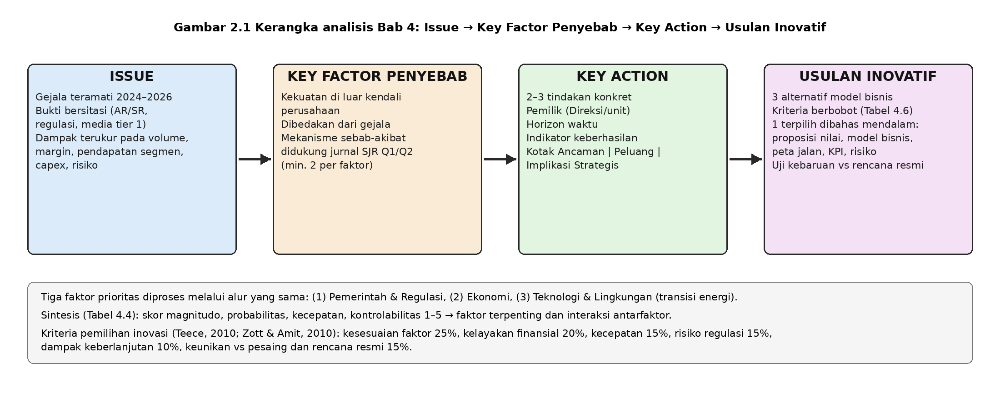

# BAB 2 LANDASAN TEORI

## 2.1 Lingkungan Umum, Lingkungan Industri, dan Sembilan Faktor

Literatur manajemen strategis membedakan lingkungan umum (*general environment*), yaitu dimensi masyarakat luas yang memengaruhi semua industri, dari lingkungan industri, yaitu kekuatan yang langsung menentukan profitabilitas suatu industri seperti pemasok, pembeli, pendatang baru, substitusi, dan rivalitas (Porter, 2008; Hitt et al., 2020). Pemindaian lingkungan umum berakar pada kerangka ETPS Aguilar (1967) dan dikembangkan oleh Fahey dan Narayanan (1986) menjadi analisis makro yang sistematis. Kerangka PESTEL (Politik, Ekonomi, Sosial, Teknologi, Lingkungan, Legal) adalah penyederhanaan yang populer di buku teks (Thompson et al., 2022; Grant, 2021). Kerangka sembilan faktor yang digunakan di kelas memperluas PESTEL dengan memisahkan Pemerintah dari Politik, menambah Demografi, dan menambah Global sebagai saluran transmisi kejutan lintas negara. Pemisahan ini berguna bagi perusahaan energi karena "Pemerintah" bekerja melalui instrumen administratif harian (kuota, penugasan, harga acuan), sedangkan "Politik" bekerja melalui koalisi yang lebih lambat berubah. Relevansi generiknya: bagi distributor energi dan pengembang kawasan industri, harga, volume impor, kewajiban pencampuran, dan status fiskal kawasan ditetapkan negara, sehingga analisis lingkungan umum adalah inti analisis strategi, bukan latar belakang.

## 2.2 Teori Pemerintah dan Regulasi: Intervensi Negara dan Strategi Nonpasar

Literatur ekonomi energi menunjukkan bahwa negara mengintervensi sektor energi melalui empat instrumen utama: kuota dan lisensi impor, mandatori produk (misalnya pencampuran biofuel), subsidi dan kompensasi harga, serta insentif lokasi seperti KEK. Coady et al. (2017, *World Development*, SJR Q1) memperkirakan subsidi energi fosil global mencapai USD 4,9 triliun pada 2013 jika memasukkan biaya eksternalitas, dan menunjukkan bahwa subsidi harga menciptakan ketergantungan fiskal yang sulit dilepaskan. Rentschler dan Bazilian (2017, *Climate Policy*, SJR Q1) menyimpulkan bahwa reformasi subsidi gagal bukan karena argumen ekonomi, melainkan karena ekonomi politik: penolakan konsumen, kepentingan BUMN, dan ketidakpercayaan pada kompensasi. Henisz (2000, *Economics & Politics*, SJR: VERIFIKASI) membangun indeks *political constraints* dan menunjukkan bahwa kredibilitas komitmen kebijakan menentukan investasi jangka panjang; semakin sedikit batasan institusional, semakin mudah pemerintah mengubah aturan secara sepihak. Untuk KEK, Frick et al. (2019, *Economic Geography*, SJR Q1) menemukan bahwa pertumbuhan zona ekonomi khusus di negara berkembang lebih ditentukan oleh akses pasar, ukuran negara, dan kedekatan dengan kota besar daripada oleh insentif fiskal semata.

Dari sisi strategi, Baron (1995, *California Management Review*, SJR Q1) memperkenalkan konsep strategi terintegrasi: perusahaan harus menggabungkan strategi pasar dengan strategi nonpasar, yaitu tindakan terkoordinasi untuk membentuk lingkungan kebijakan melalui informasi, lobi, koalisi, dan reputasi. Hillman et al. (2004, *Journal of Management*, SJR Q1) merangkum bukti bahwa *corporate political activity* efektif ketika perusahaan memiliki keahlian informasi yang dibutuhkan regulator dan membangun hubungan relasional jangka panjang, bukan transaksional. Relevansi generik bagi distributor energi dan pengembang KEK: perusahaan tidak dapat memperlakukan kebijakan sebagai variabel eksogen murni. Kemampuan menyediakan data kebutuhan pasokan, menjalankan penugasan negara dengan andal, dan menjadi mitra pelaksana program nasional adalah aset strategis yang sama pentingnya dengan terminal dan armada.

## 2.3 Teori Ekonomi: Siklus Komoditas, Pass-Through, Kurs, dan Hedging

Kilian (2009, *American Economic Review*, SJR Q1) menunjukkan bahwa guncangan harga minyak tidak seragam: guncangan pasokan, guncangan permintaan agregat, dan guncangan permintaan spekulatif memiliki dampak makro yang berbeda. Hamilton (2009, *Brookings Papers on Economic Activity*, SJR: VERIFIKASI) menunjukkan bahwa guncangan harga minyak 2007–2008 memperlambat konsumsi dan memicu resesi melalui penurunan daya beli. Pada tingkat harga eceran, Borenstein et al. (1997, *Quarterly Journal of Economics*, SJR Q1) membuktikan asimetri *rockets and feathers*: harga BBM eceran naik cepat ketika harga minyak naik dan turun lambat ketika harga minyak turun, karena kekuatan pasar dan biaya pencarian konsumen. Basher et al. (2012, *Energy Economics*, SJR Q1) menemukan bahwa kenaikan harga minyak melemahkan kurs negara berkembang pengimpor minyak dan menekan pasar sahamnya. Mengenai *hedging*, Froot et al. (1993, *Journal of Finance*, SJR Q1) menjelaskan bahwa lindung nilai bernilai bagi perusahaan karena menstabilkan arus kas internal sehingga investasi tidak terganggu ketika pendanaan eksternal mahal.

Relevansi generik: margin distributor ditentukan mekanisme *pass-through*. Jika harga beli dapat diteruskan melalui formula (misalnya *Mean of Platts Singapore* plus biaya), risiko harga berubah menjadi risiko volume dan modal kerja; jika harga jual diatur negara, risiko berpindah ke kompensasi fiskal yang tertunda. Bagi pengembang kawasan industri, siklus komoditas menentukan waktu investasi tenant, sehingga penjualan lahan bersifat siklikal.

## 2.4 Teori Teknologi dan Lingkungan: Disrupsi, S-Curve, Transisi Multi-Level, dan Stranded Assets

Bower dan Christensen (1995) membedakan teknologi berkelanjutan dari teknologi disruptif yang awalnya berkinerja lebih rendah pada atribut yang dihargai pelanggan utama, tetapi unggul pada atribut lain dan membaik cepat; *incumbent* gagal bukan karena tidak mampu, melainkan karena proses alokasi sumber dayanya mengabaikan pasar kecil. Christensen et al. (2015) menegaskan bahwa disrupsi adalah proses, bukan peristiwa, dan bahwa banyak inovasi yang disebut disruptif sebenarnya adalah inovasi berkelanjutan. Geroski (2000, *Research Policy*, SJR Q1) merangkum model difusi: adopsi teknologi mengikuti kurva S yang lambat di awal, cepat di tengah, dan jenuh di akhir, dengan kecepatan ditentukan oleh informasi, heterogenitas pengadopsi, dan jaringan pelengkap. Geels (2002, *Research Policy*, SJR Q1) merumuskan perspektif multi-level (MLP): transisi sosioteknis terjadi ketika inovasi di *niche* bertemu tekanan dari *landscape* (iklim, geopolitik) yang mendestabilisasi *regime* yang mapan. Unruh (2000, *Energy Policy*, SJR Q1) menjelaskan *carbon lock-in*: infrastruktur fosil bertahan karena skala ekonomi, jaringan, dan institusi yang saling menguatkan.

Mercure et al. (2018, *Nature Climate Change*, SJR Q1) memodelkan bahwa transisi energi dapat menghapus nilai aset fosil sebesar USD 1–4 triliun bahkan tanpa kebijakan iklim baru, karena difusi teknologi rendah karbon yang sudah berjalan; aset yang kehilangan nilai sebelum akhir umur ekonomisnya disebut *stranded assets*. Untuk adopsi kendaraan listrik (EV), Li et al. (2017, *Journal of the Association of Environmental and Resource Economists*, SJR Q1) membuktikan efek jaringan tidak langsung antara jumlah EV dan jumlah stasiun pengisian, sedangkan Sierzchula et al. (2014, *Energy Policy*, SJR Q1) menemukan bahwa insentif fiskal dan kepadatan infrastruktur pengisian adalah prediktor kuat pangsa EV antarnegara. Tekanan lingkungan pada perdagangan ditunjukkan Dechezleprêtre dan Sato (2017, *Review of Environmental Economics and Policy*, SJR Q1): regulasi lingkungan memindahkan pola perdagangan dan investasi, sehingga perbedaan standar karbon antarnegara menjadi faktor daya saing ekspor.

Relevansi generik: distributor BBM adalah bagian rezim fosil yang tidak runtuh seketika, tetapi tergerus dari segmen ritel perkotaan yang paling cepat terelektrifikasi, sementara segmen industri, pertambangan, dan maritim bertahan lebih lama. Pengembang kawasan industri berada di posisi sebaliknya sebagai *niche* penyedia energi rendah karbon bagi tenant yang ditekan pembeli global; kombinasi kedua posisi ini mendasari usulan inovasi Bab 4.

## 2.5 Faktor Mana yang Paling Penting bagi Perusahaan Distribusi Energi Indonesia

Penentuan faktor terpenting menggunakan tiga kriteria: magnitudo (seberapa besar pengaruh pada pendapatan dan margin), imediasi (seberapa cepat pengaruh terasa), dan kontrolabilitas (seberapa besar perusahaan dapat memengaruhi faktor itu). Faktor Ekonomi memiliki imediasi tertinggi, tetapi dampaknya pada margin dapat diredam kontrak formula dan lindung nilai. Faktor Teknologi dan Lingkungan bermagnitudo besar dalam jangka panjang, tetapi imediasinya rendah bagi segmen industri yang mendominasi laba. Faktor Pemerintah dan Regulasi memiliki magnitudo tertinggi karena ia menetapkan apakah volume boleh dijual sama sekali (kuota dan penugasan), berapa harga jualnya (harga eceran bersubsidi dan kompensasi), produk apa yang wajib dijual (B40 menjadi B50), dan berapa pajak yang dibayar tenant kawasan (fasilitas KEK). Imediasinya tinggi karena keputusan administratif berlaku dalam hitungan minggu, dan kontrolabilitasnya rendah meskipun strategi nonpasar dapat memperbaiki posisi perusahaan di margin.

**Posisi laporan ini tegas: faktor Pemerintah dan Regulasi adalah faktor paling penting bagi perusahaan distribusi energi di Indonesia.** Argumennya bersifat struktural, bukan situasional. Pertama, Indonesia menempatkan BBM sebagai barang strategis dengan harga eceran bersubsidi yang ditetapkan negara dan distribusi yang didominasi BUMN, sehingga pasar BBM bukan pasar bebas melainkan pasar yang diadministrasi. Kedua, instrumen negara bekerja langsung pada volume dan harga, berbeda dengan faktor ekonomi yang bekerja melalui biaya input yang dapat diteruskan, dan faktor teknologi yang bekerja melalui substitusi permintaan dalam horizon puluhan tahun. Ketiga, faktor pemerintah juga memediasi dua faktor lainnya: kecepatan transisi energi di Indonesia ditentukan oleh mandatori biofuel, insentif EV, dan aturan ketenagalistrikan, sementara transmisi guncangan harga minyak ke konsumen ditentukan oleh keputusan harga eceran dan kompensasi fiskal. Implikasinya, kapabilitas membaca, mengantisipasi, dan ikut membentuk kebijakan adalah kompetensi inti yang harus dimiliki perusahaan, dan diversifikasi menuju pendapatan yang tidak bergantung pada kuota (utilitas kawasan, logistik pihak ketiga) adalah lindung nilai strategis terhadap faktor ini.

## 2.6 Kerangka Analisis dan Kriteria Pemilihan Inovasi

Kerangka analisis Bab 4 mengikuti alur empat tahap pada Gambar 2.1. *Issue* adalah gejala yang teramati pada 2024–2026 dengan bukti bersitasi. *Key factor* penyebab adalah kekuatan di luar kendali perusahaan yang menjelaskan mengapa gejala itu muncul, dibedakan dari gejala itu sendiri dan didukung mekanisme sebab-akibat dari literatur. *Key action* adalah tindakan konkret perusahaan dengan pemilik, horizon, dan indikator. Usulan inovatif adalah respons yang mengubah model bisnis, bukan hanya memperbaiki operasi.



Kriteria pemilihan inovasi mengikuti literatur inovasi model bisnis. Teece (2010, *Long Range Planning*, SJR Q1) menegaskan bahwa model bisnis menjelaskan bagaimana perusahaan menciptakan nilai bagi pelanggan dan menangkap sebagian nilai itu, sehingga inovasi model bisnis harus dinilai dari proposisi nilai, mekanisme penangkapan nilai, dan kesulitan untuk ditiru. Zott dan Amit (2010, *Long Range Planning*, SJR Q1) memandang model bisnis sebagai sistem aktivitas yang saling bergantung; kebaruan muncul dari konten aktivitas baru, struktur keterkaitan baru, atau tata kelola baru. Dari dua sumber ini dan dari konteks Bab 4, laporan ini menetapkan enam kriteria berbobot: kesesuaian dengan tiga faktor prioritas (25%), kelayakan finansial berdasarkan kapasitas neraca (20%), kecepatan implementasi (15%), risiko regulasi (15%), dampak keberlanjutan (10%), dan keunikan dibanding pesaing serta rencana resmi perusahaan (15%). Bobot terbesar pada kesesuaian faktor karena tugas laporan ini adalah menjawab lingkungan eksternal; bobot keunikan dipisahkan agar usulan yang hanya mengulang rencana resmi perusahaan tidak lolos sebagai inovasi.

```{=openxml}
<w:p><w:r><w:br w:type="page"/></w:r></w:p>
```
