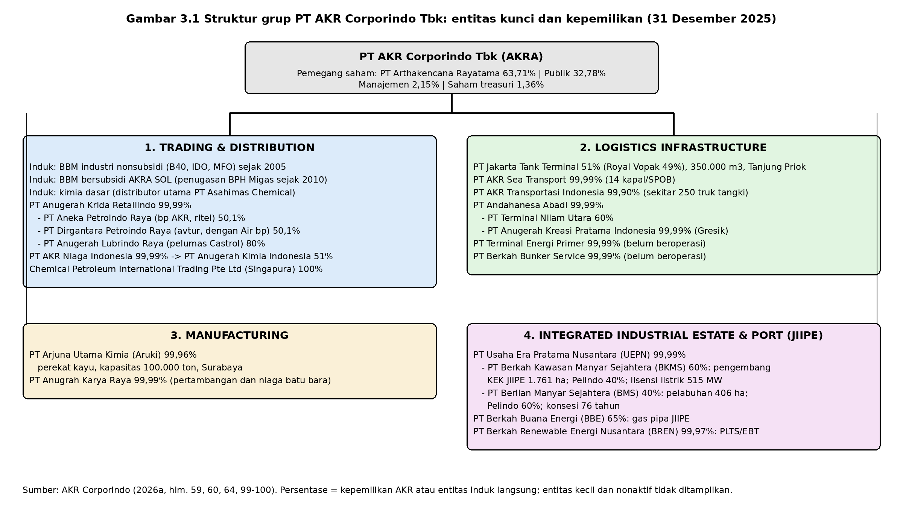

# BAB 3 PROFIL INDUSTRI DAN ENTITAS

## 3.1 Industri Distribusi BBM dan Kimia Dasar di Indonesia

Industri hilir migas Indonesia diatur oleh Kementerian ESDM (kebijakan, kuota impor, harga acuan, mandatori biofuel) dan Badan Pengatur Hilir Minyak dan Gas Bumi (BPH Migas) yang menetapkan kuota dan penugasan penyaluran BBM bersubsidi serta BBM penugasan. Pasar terbagi menjadi BBM bersubsidi dan penugasan (Solar bersubsidi, Pertalite) yang harganya ditetapkan pemerintah dan selisihnya dibayar melalui subsidi dan kompensasi, serta BBM nonsubsidi (RON 92 ke atas, Dexlite, Dex) yang harganya ditetapkan badan usaha dengan mengacu pada formula Kepmen ESDM. Realisasi subsidi dan kompensasi energi mencapai Rp376,8 triliun hingga 30 September 2026, naik 54,1% dari periode yang sama 2025, dengan volume BBM bersubsidi 13,41 juta kiloliter (ANTARA, 9 Oktober 2026; Kontan, 10 Oktober 2026). Pertamina melalui PT Pertamina Patra Niaga mendominasi ritel dengan lebih dari 6.400 SPBU [VERIFIKASI: jumlah SPBU Pertamina 2026, CNBC Indonesia 10 Juli 2026], sementara pemain swasta—Shell, bp AKR, Vivo, dan ExxonMobil—bergantung pada kuota impor yang ditetapkan per periode. Pada 2025 kuota itu habis pada pertengahan Agustus untuk Shell dan bp AKR serta Oktober untuk Vivo; kuota 2026 dinaikkan sekitar 10% dan persetujuan dikembalikan ke skema enam bulanan (Katadata, 5 Januari 2026; Bloomberg Technoz, 26 Januari 2026). Mandatori biodiesel naik dari B40 (sejak 1 Januari 2025) ke B50 melalui Kepmen ESDM Nomor 257.K/EK.01/MEM.E/2026 yang berlaku 1 Juli 2026 dengan masa transisi hingga peredaran nasional 1 Oktober 2026 (CNBC Indonesia, 1 Juli 2026; CNBC Indonesia, 10 Juli 2026). Implementasi B40 pada 2025 menyerap sekitar 15,6 juta kiloliter biodiesel (AKR Corporindo, 2026a, hlm. 140).

Segmen BBM industri nonsubsidi (solar industri, IDO, MFO) lebih terbuka: pemegang izin niaga umum dapat mengimpor dan menjual langsung ke pertambangan, pembangkit, pabrik, dan kapal dengan harga formula. Pelanggan terbesar adalah pertambangan dan smelter; per 2025 Indonesia memiliki 54 smelter nikel beroperasi, 38 dalam konstruksi, dan 45 direncanakan (AKR Corporindo, 2026a, hlm. 140). Industri kimia dasar bersifat *business-to-business*; distributor bersaing pada keandalan pasokan, kapasitas tangki, dan jangkauan pelabuhan. Tabel 3.1 merangkum pemain utama.

**Tabel 3.1 Pemain utama distribusi BBM ritel dan industri di Indonesia**

| Pemain | Status | Segmen utama | Sumber pasokan | Catatan 2025–2026 |
|---|---|---|---|---|
| PT Pertamina Patra Niaga | BUMN | Ritel bersubsidi dan nonsubsidi, industri, avtur | Kilang Pertamina + impor | >6.400 SPBU [VERIFIKASI]; menjual *base fuel* ke swasta sejak akhir 2025 |
| bp AKR (PT Aneka Petroindo Raya, AKR 50,1%) | Swasta, JV bp–AKR | Ritel nonsubsidi RON 92/95, diesel | Impor dengan kuota ESDM; pembelian 100.000 barel *base fuel* dari Pertamina (Okt–Nov 2025) | 72 SPBU akhir 2025 (AKR Corporindo, 2026a, hlm. 69); kuota habis Agustus 2025 |
| Shell Indonesia | Swasta asing | Ritel nonsubsidi, pelumas | Impor dengan kuota | Kuota habis Agustus 2025; jumlah SPBU [VERIFIKASI] |
| Vivo Energy Indonesia | Swasta | Ritel nonsubsidi | Impor dengan kuota | Kuota habis Oktober 2025; jumlah SPBU [VERIFIKASI] |
| ExxonMobil (Mobil) | Swasta asing | Ritel nonsubsidi, pelumas | Impor dengan kuota | Jaringan terbatas [VERIFIKASI] |
| PT AKR Corporindo Tbk (induk) | Swasta, Tbk | BBM industri nonsubsidi, BBM bersubsidi penugasan BPH Migas (AKRA SOL), kimia dasar | Impor + FAME domestik; penugasan 181.000 KL solar 2026 (AKR Corporindo, 2026a, hlm. 411) | Satu-satunya swasta penyalur BBM bersubsidi sejak 2010 (AKR Corporindo, 2026a, hlm. 69) |

Sumber: AKR Corporindo (2026a); Katadata (5 Januari 2026); Katadata (7 November 2025); Bisnis Indonesia (24 November 2025); kompilasi penulis. Angka pesaing bertanda [VERIFIKASI] perlu dicek ke laporan masing-masing.

## 3.2 Industri Kawasan Industri Terpadu dan Kawasan Ekonomi Khusus

Kawasan Ekonomi Khusus diatur Undang-Undang Nomor 39 Tahun 2009 sebagaimana diubah melalui UU Cipta Kerja dan Peraturan Pemerintah Nomor 40 Tahun 2021 tentang penyelenggaraan KEK, yang memberikan fasilitas *tax holiday*, pembebasan bea masuk dan PPN untuk barang modal, serta perizinan terpadu melalui Administrator KEK. JIIPE ditetapkan sebagai KEK Gresik melalui PP Nomor 71 Tahun 2021 dan dinyatakan beroperasi melalui Keputusan Menko Perekonomian Nomor 1 Tahun 2022 (AKR Corporindo, 2026a, hlm. 118). Dalam agenda hilirisasi mineral, JIIPE berperan sebagai lokasi smelter tembaga *single line* dan *Precious Metal Refinery* PT Freeport Indonesia, pabrik kaca dan kaca surya Xinyi, *copper foil* Hailiang, serta pabrik kimia Golden Elephant Specialty Chemicals senilai sekitar USD 600 juta (AKR Corporindo, 2026a, hlm. 118, 120; AKR Corporindo, 2026b, hlm. 36). Klaster logam–kimia–kaca ini memberi JIIPE posisi berbeda dari kawasan industri Jawa Barat dan Banten yang didominasi otomotif dan elektronik; pesaing langsung untuk tenant berbasis pelabuhan laut dalam di Jawa Timur relatif terbatas, meskipun kawasan industri di Kendal, Batang, dan Subang bersaing untuk investasi manufaktur umum [VERIFIKASI: perbandingan kawasan pesaing dari HKI/Kemenperin].

Frick et al. (2019) menunjukkan bahwa KEK yang berhasil menyediakan akses pasar dan infrastruktur, bukan sekadar insentif pajak, dan Wang (2013, *Journal of Development Economics*, SJR Q1) menemukan KEK Tiongkok menaikkan investasi asing dan upah. Keunggulan JIIPE memang bersifat fisik: pelabuhan −16 LWS dengan dermaga 6.200 meter dan kapasitas kapal 100.000 DWT, listrik berlisensi 515 MW dengan pasokan gas pipa PGN dan dukungan PLN 500 MVA, desalinasi 2.400 m³/hari, serta pengolahan limbah 2.500 m³/hari (AKR Corporindo, 2026a, hlm. 118–119).

## 3.3 Profil PT AKR Corporindo Tbk

AKR memulai usaha perdagangan kimia dasar di Surabaya pada 1960; badan hukum PT Aneka Kimia Raya didirikan dengan Akta Nomor 46 tanggal 28 November 1977, tercatat di Bursa Efek Indonesia pada 3 Oktober 1994 dengan kode AKRA, dan berganti nama menjadi PT AKR Corporindo Tbk pada 23 September 2004 (AKR Corporindo, 2026a, hlm. 8, 60–61, 64). Laporan Tahunan menyebut tahun pendirian 1970 pada halaman 8 dan akta 1977 pada halaman 60; laporan ini menggunakan tahun akta. Per 31 Desember 2025 pemegang saham pengendali adalah PT Arthakencana Rayatama 63,71%, publik 32,78%, manajemen 2,15%, dan saham treasuri 1,36%, dengan 2.474 karyawan (AKR Corporindo, 2026a, hlm. 59). Visi perusahaan adalah menjadi penyedia terdepan jasa logistik dan solusi pengadaan untuk bahan kimia dan energi di Indonesia, dan misinya mengoptimalkan potensi untuk membangun nilai pemangku kepentingan yang berkelanjutan (AKR Corporindo, 2026a, hlm. 198) [VERIFIKASI: redaksi resmi visi-misi pada AR hlm. 6]. Nilai perusahaan mencakup *Be Agile*, *Empower Your Team*, dan *Zero Tolerance* (AKR Corporindo, 2026a, hlm. 63). Lima pilar strategis 2025 adalah *Energy & Industrial Connectivity*, *Operational Excellence & Financial Resilience*, *Trusted Governance & Responsible Growth*, *Integrated & Competitive Industrial Ecosystems*, dan *Strategic Partnerships & Market Confidence* (AKR Corporindo, 2026a, hlm. 7).

Empat segmen operasi resmi adalah (1) Trading and Distribution of Petroleum and Basic Chemicals, (2) Logistics Infrastructure, (3) Manufacturing, dan (4) Integrated Industrial Estate and Port (AKR Corporindo, 2026a, hlm. 68). Segmen pertama mencakup BBM industri nonsubsidi (B40, IDO, MFO) sejak 2005, ritel nonsubsidi melalui bp AKR sejak 2017, BBM bersubsidi melalui SPBKB dan SPBN AKRA SOL dengan penugasan BPH Migas selama hampir 16 tahun termasuk program BBM Satu Harga di daerah 3T, alokasi FAME terbesar di antara swasta untuk B40, kimia dasar sebagai distributor utama PT Asahimas Chemical, pelumas Castrol melalui PT Anugerah Lubrindo Raya (80%), dan avtur melalui PT Dirgantara Petroindo Raya (50,1%, bersama Air bp) (AKR Corporindo, 2026a, hlm. 68–70, 99–100). Segmen logistik mencakup PT Jakarta Tank Terminal (51%, bersama Royal Vopak, kapasitas 350.000 m³), PT AKR Sea Transport, dan PT AKR Transportasi Indonesia; segmen manufaktur adalah PT Arjuna Utama Kimia (perekat kayu, kapasitas 100.000 ton); segmen kawasan industri dijalankan melalui PT Usaha Era Pratama Nusantara yang memiliki 60% PT Berkah Kawasan Manyar Sejahtera (pengembang; Pelindo 40%) dan 40% PT Berlian Manyar Sejahtera (pelabuhan; konsesi 76 tahun), serta PT Berkah Buana Energi (65%, gas pipa) dan PT Berkah Renewable Energi Nusantara (99,97%, pembangkit EBT) (AKR Corporindo, 2026a, hlm. 60, 64, 99–100, 116–117). Jejak operasi mencakup 19 pelabuhan laut dan sungai, 21 terminal tangki berkapasitas 820.400 KL, 14 kapal dan SPOB, sekitar 250 truk tangki, dan 176 SPBU gabungan AKR dan bp AKR (AKR Corporindo, 2026a, hlm. 15; AKR Corporindo, 2026b, hlm. 18). Gambar 3.1 merangkum struktur grup.



## 3.4 Ikhtisar Kinerja 2021–2025

**Tabel 3.2 Ikhtisar kinerja PT AKR Corporindo Tbk 2021–2025 (Rp miliar kecuali dinyatakan lain)**

| Indikator | 2021 | 2022 | 2023 | 2024 | 2025 |
|---|---|---|---|---|---|
| Pendapatan | 25.707 | 47.540 | 42.087 | 38.729 | 46.018 |
| Laba kotor | 2.293 | 4.252 | 4.473 | 3.509 | 4.098 |
| Margin laba kotor (%) | 8,9 | 8,9 | 10,6 | 9,1 | 8,9 |
| Laba usaha | 1.455 | 3.087 | 3.561 | 2.578 | 3.084 |
| Laba bersih pemilik entitas induk | 1.112 | 2.403 | 2.780 | 2.225 | 2.473 |
| Total aset | 23.509 | 27.188 | 30.297 | 33.109 | 36.562 |
| Total ekuitas | 11.299 | 13.155 | 14.043 | 14.624 | 15.610 |
| Kas dan setara kas | 2.600 | 4.338 | 6.536 | 5.366 | 6.404 |
| ROE (%) | 11,9 | 21,9 | 24,7 | 19,2 | 20,3 |
| Net gearing (kali) | 0,02 | −0,12 | −0,16 | −0,04 | −0,08 |
| Dividen per saham tahun buku (Rp) | [VERIFIKASI] | 75 | 125 | 100 | [belum diputuskan] |
| Volume BBM (KL) | [VERIFIKASI] | [VERIFIKASI] | [VERIFIKASI] | [VERIFIKASI] | [VERIFIKASI] |
| Volume kimia dasar (ton) | [VERIFIKASI] | [VERIFIKASI] | [VERIFIKASI] | [VERIFIKASI] | [VERIFIKASI] |
| Penjualan lahan JIIPE (ha) | [VERIFIKASI] | [VERIFIKASI] | [VERIFIKASI] | 38 | 84 |

Sumber: AKR Corporindo (2026a, hlm. 24–26, 30, 118); AKR Corporindo (2025, hlm. 26, 112). Volume BBM dan kimia dasar tidak diungkapkan dalam satuan fisik pada AR 2025 yang ditelaah; perlu dicek ke paparan publik perusahaan. AR 2024 menyebut penjualan lahan 2024 sebesar 38 ha (hlm. 112) dan 37 ha (hlm. 130).

**Tabel 3.3 Pendapatan dan laba kotor per segmen 2024–2025 (Rp miliar)**

| Segmen | Pendapatan 2024 | Pendapatan 2025 | Pertumbuhan | Laba kotor 2025 | Margin 2025 | Kontribusi laba kotor 2025 |
|---|---|---|---|---|---|---|
| Trading & Distribution | 35.532 | 41.314 | +16% | 3.004 | 7,3% | 73% |
| — Petroleum | 28.934 | 34.013 | +18% | — | — | — |
| — Basic Chemicals | 6.598 | 7.301 | +11% | — | — | — |
| Logistics Services | 1.165 | 1.499 | +29% | 49 | 3,3% | 1% |
| Manufacturing | 652 | 464 | −29% | 208 | 44,8% | 5% |
| Industrial Estate (JIIPE) | 1.381 | 2.741 | +99% | 836 | 30,5% | 20% |
| **Konsolidasi** | **38.729** | **46.018** | **+19%** | **4.098** | **8,9%** | **100%** |

Sumber: AKR Corporindo (2026a, hlm. 114–117, 120–121); kontribusi dihitung penulis.

Tren 2021–2025 menunjukkan tiga hal. Pertama, pendapatan sangat sensitif terhadap harga minyak: lonjakan 2022 dan penurunan 2023–2024 mengikuti harga produk, sementara laba kotor relatif stabil pada Rp3,5–4,5 triliun, konsisten dengan model *formula-based pricing* yang mengubah risiko harga menjadi risiko volume (AKR Corporindo, 2026b, hlm. 76). Kedua, laba bergeser ke kawasan industri dan utilitas: kontribusi JIIPE pada laba kotor naik menjadi 20% pada 2025, dengan pendapatan utilitas berulang Rp727 miliar yang tumbuh 129% dan penjualan lahan Rp1.820 miliar yang tumbuh 107% (AKR Corporindo, 2026a, hlm. 117). Ketiga, neraca menguat: kas Rp6,4 triliun, posisi kas bersih, dan rasio pembayaran dividen 88,77% untuk tahun buku 2024 menunjukkan kapasitas pendanaan internal yang besar, sementara belanja modal 2025 hanya Rp897 miliar (AKR Corporindo, 2026a, hlm. 26, 30, 136). Manajemen memproyeksikan laba bersih 2026 tumbuh 7–10%, laba kotor Trading and Distribution tumbuh 4–6%, dan penjualan lahan 90–100 ha (AKR Corporindo, 2026a, hlm. 137); realisasi sembilan bulan 2026 dilaporkan Rp2,21 triliun (+34%) dengan pendapatan Rp46,53 triliun (Kontan, Oktober 2026) [VERIFIKASI: laporan keuangan 30 September 2026 di BEI; satu media melaporkan Rp2,44 triliun].

## 3.5 Posisi Kompetitif

Keunggulan AKR bertumpu pada tiga hal. Pertama, infrastruktur logistik terintegrasi—19 pelabuhan, 820.400 KL tangki, armada laut dan darat, serta sistem pemantauan *terminal-to-nozzle* waktu nyata—yang sulit ditiru pendatang baru dan menjadi dasar penugasan BBM bersubsidi (AKR Corporindo, 2026a, hlm. 15, 115). Kedua, neraca kas bersih dengan arus kas operasi Rp3.941 miliar pada 2025 (AKR Corporindo, 2026a, hlm. 26) yang memungkinkan investasi tanpa tekanan pendanaan eksternal. Ketiga, JIIPE sebagai KEK dengan pelabuhan laut dalam dan lisensi listrik 515 MW yang menempatkan AKR sebagai penyedia utilitas, bukan hanya penjual lahan. Kerentanannya juga tiga. Pertama, ketergantungan pada kuota impor dan penugasan: Laporan Tahunan menyatakan bahwa sebagian besar BBM dan kimia dasar yang didistribusikan adalah impor dan bahwa pembatasan kuota atau tarif dapat memengaruhi kinerja (AKR Corporindo, 2026a, hlm. 236). Kedua, margin tipis 7,3% pada segmen inti yang menyumbang 90% pendapatan. Ketiga, pendapatan lahan JIIPE yang tidak berulang: dari Rp2.741 miliar pendapatan JIIPE 2025, Rp1.820 miliar adalah penjualan lahan yang bergantung pada keputusan investasi tenant besar, sementara margin kotor segmen turun dari 43,3% ke 30,5% (AKR Corporindo, 2026a, hlm. 117, 121).

```{=openxml}
<w:p><w:r><w:br w:type="page"/></w:r></w:p>
```
