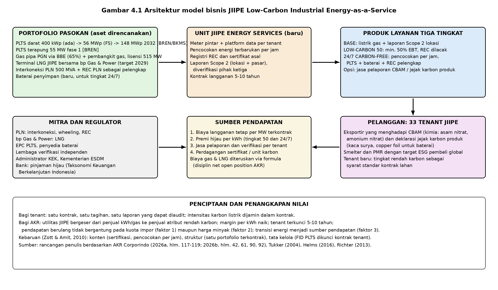

## 4.5 Tiga Alternatif Inovasi

Tiga alternatif di bawah ini dirumuskan dari interaksi faktor pada 4.4. Masing-masing menjawab kombinasi faktor yang berbeda, dan deskripsinya dipertajam supaya lolos uji kebaruan terhadap rencana resmi AKR.

### 4.5.1 Alternatif A: JIIPE Low-Carbon Industrial Energy-as-a-Service

Deskripsi: BKMS bersama BREN dan BBE menawarkan paket energi industri berlangganan kepada tenant JIIPE. Isinya pasokan listrik dengan kadar rendah karbon yang dikontrak (misalnya 30%, 60%, atau *24/7 matched*), sertifikat energi terbarukan (*renewable energy certificate*, REC) yang bisa dilacak, gas pipa dan nantinya LNG sebagai pasokan dasar, serta laporan emisi *Scope 2* metode berbasis pasar yang diverifikasi pihak ketiga dan siap dipakai untuk pelaporan ke pembeli global dan CBAM. Faktor yang dijawab: faktor 3 (permintaan energi rendah karbon tenant), faktor 1 (memanfaatkan lisensi 515 MW dan status KEK, mengurangi ketergantungan laba pada kuota), dan faktor 2 (pendapatan berulang berbasis kontrak yang tidak ikut harga minyak). Investasi [ESTIMASI]: PLTS darat 56 MWp sekitar Rp600–750 miliar dan PLTS terapung 55 MW sekitar Rp750–950 miliar (asumsi biaya USD 0,65–0,8 juta per MWp dan USD 0,8–1,0 juta per MW terapung pada kurs Rp16.500–17.500), ditambah meter pintar, platform data, dan sertifikasi sekitar Rp60–100 miliar. Totalnya Rp1,4–1,8 triliun selama tiga tahun. Pendanaan: kas internal Rp6,4 triliun dan arus kas operasi Rp3,9 triliun per tahun, ditambah pinjaman hijau atau obligasi berwawasan lingkungan sesuai Taksonomi untuk Keuangan Berkelanjutan Indonesia, dengan kemungkinan mitra ekuitas di tingkat proyek PLTS. Risiko utama: aturan ketenagalistrikan dalam wilayah usaha dan harga jual listrik EBT, integritas REC (dibahas di 4.7), dan kemungkinan tenant tidak mau tingkat premium.

Uji kebaruan: AKR sudah merencanakan PLTS 56 MWp menuju 148 MWp, PLTS terapung 55 MW, LNG 2029, dan gas pipa BBE. AKR juga sudah menjual utilitas senilai Rp727 miliar (AKR Corporindo, 2026a, hlm. 117; AKR Corporindo, 2026b, hlm. 42, 61, 92), dan JTT sudah memakai REC untuk operasinya sendiri (AKR Corporindo, 2026b, hlm. 90). Batas kebaruan usulan ini ada pada model bisnisnya. Energi dijual sebagai layanan berkontrak dengan atribut karbon yang dijamin dan dilaporkan, bukan sebagai kWh dan gas. Pendapatan bergeser dari tarif per volume ke langganan bertingkat dan jasa pelaporan. Keputusan investasi PLTS dikunci oleh kontrak tenant, bukan dibangun dulu sambil berharap ada pembeli.

### 4.5.2 Alternatif B: bp AKR Multi-Energy Mobility Hub

Deskripsi: mengubah SPBU bp AKR di koridor logistik dan tol Jawa (Cipularang, Trans-Jawa, Pasuruan sampai Probolinggo) menjadi stasiun multi-energi yang menjual bensin, B50, pengisian cepat EV minimal 120 kW lewat kemitraan dengan operator pengisian, serta ritel non-BBM dan layanan armada logistik. Faktor yang dijawab: faktor 3 (elektrifikasi dan B50) dan sebagian faktor 1 (mengurangi ketergantungan gerai pada kuota bensin). Investasi [ESTIMASI]: Rp3–5 miliar per gerai untuk dua sampai empat pengisi cepat dan penataan ritel, atau Rp150–250 miliar untuk 50 gerai dalam tiga tahun, didanai bp AKR (50,1% AKR) dan mitra pengisian dengan bagi hasil. Risiko utama: pengisi daya sepi di tahun-tahun awal, persaingan dengan Pertamina dan operator pengisian independen yang sudah ada di rest area, dan tarif listrik untuk pengisian yang diatur. Uji kebaruan: AKR menyebut "Advancing EV ecosystem" sebagai peluang tanpa rincian dan sedang memperluas jaringan SPBU (AKR Corporindo, 2026b, hlm. 65; AKR Corporindo, 2026a, hlm. 50). Pertamina dan Shell sudah mengoperasikan pengisi daya di sebagian SPBU [VERIFIKASI: jumlah SPKLU di SPBU Pertamina dan Shell 2026]. Baru bagi AKR, tetapi tidak baru bagi industri. Sifatnya mengikuti pesaing.

### 4.5.3 Alternatif C: AKR Integrated Energy & Chemical Logistics Platform

Deskripsi: membuka kapasitas tangki 820.400 KL, 19 pelabuhan, 14 kapal, dan 250 truk sebagai layanan logistik pihak ketiga berbasis data (*logistics-as-a-service*) untuk industri hilirisasi di Sulawesi dan Indonesia Timur. Ada platform digital yang menampilkan ketersediaan tangki dan jadwal kapal secara waktu nyata, kontrak *take-or-pay*, dan integrasi dengan sistem pelanggan. Faktor yang dijawab: faktor 2 (pendapatan jasa yang tidak ikut harga minyak) dan faktor 1 (pendapatan di luar kuota). Investasi [ESTIMASI]: Rp400–700 miliar untuk tangki dan kapal tambahan di Morowali dan Bitung, ditambah Rp50 miliar platform, didanai kas internal. Risiko utama: rebutan kapasitas antara dagang sendiri dan pihak ketiga, margin logistik yang tipis (3,3% pada 2025), dan ketergantungan pada siklus smelter nikel. Uji kebaruan: AKR sudah menyewakan tangki lewat JTT, sudah memakai AI untuk perencanaan distribusi sejak 2025, dan sudah merencanakan ekspansi logistik ke Indonesia Timur (AKR Corporindo, 2026a, hlm. 50, 117, 141; AKR Corporindo, 2026b, hlm. 42). Yang baru adalah membuka kapasitas secara sistematis ke pihak ketiga lewat platform, tetapi marginnya tipis dan keunikannya terhadap pesaing logistik curah terbatas.

**Tabel 4.5 Ringkasan tiga alternatif inovasi**

| Aspek | A. Low-Carbon Industrial EaaS | B. Multi-Energy Mobility Hub | C. Logistics Platform |
|---|---|---|---|
| Faktor yang dijawab | 1, 2, 3 | 3, sebagian 1 | 2, sebagian 1 |
| Investasi 3 tahun [ESTIMASI] | Rp1,4–1,8 triliun | Rp150–250 miliar | Rp450–750 miliar |
| Sumber pendanaan | Kas internal, pinjaman hijau, mitra proyek | bp AKR dan mitra pengisian | Kas internal |
| Sifat pendapatan | Berulang, berkontrak multi-tahun | Transaksional, bergantung lalu lintas | Berulang, *take-or-pay* |
| Risiko regulasi | Sedang (aturan ketenagalistrikan, REC) | Sedang sampai tinggi (kuota bensin, tarif pengisian) | Rendah |
| Kebaruan vs rencana resmi | Tinggi pada model bisnis | Sedang | Sedang |

Sumber: analisis penulis.

## 4.6 Matriks Pemilihan

**Tabel 4.6 Matriks pemilihan alternatif inovasi (skor 1–5, berbobot)**

| Kriteria | Bobot | A | B | C | A × bobot | B × bobot | C × bobot |
|---|---|---|---|---|---|---|---|
| Kesesuaian dengan tiga faktor prioritas | 25% | 5 | 3 | 3 | 1,25 | 0,75 | 0,75 |
| Kelayakan finansial (kapasitas neraca) | 20% | 4 | 5 | 4 | 0,80 | 1,00 | 0,80 |
| Kecepatan implementasi | 15% | 3 | 4 | 4 | 0,45 | 0,60 | 0,60 |
| Risiko regulasi (5 = paling rendah) | 15% | 3 | 2 | 4 | 0,45 | 0,30 | 0,60 |
| Dampak keberlanjutan | 10% | 5 | 3 | 2 | 0,50 | 0,30 | 0,20 |
| Keunikan vs pesaing dan rencana resmi | 15% | 5 | 2 | 3 | 0,75 | 0,30 | 0,45 |
| Total | 100% | | | | 4,20 | 3,25 | 3,40 |

Sumber: penilaian penulis.

Alasan skornya begini. A unggul pada kesesuaian faktor karena satu-satunya yang menjawab ketiga faktor sekaligus, dan pada keunikan karena belum ada kawasan industri di Indonesia yang menjual energi sebagai layanan bersertifikat [VERIFIKASI: survei kawasan industri HKI]. A hanya dapat 3 pada kecepatan karena PLTS 56 MWp masih studi kelayakan, dan 3 pada risiko regulasi karena aturan jual beli listrik EBT dalam wilayah usaha swasta belum pasti. B unggul pada kelayakan finansial karena investasinya kecil, tetapi lemah pada risiko regulasi dan keunikan. C aman secara regulasi, tetapi dampak keberlanjutan dan keunikannya rendah. Kelayakan finansial A tetap 4 karena total investasi Rp1,4–1,8 triliun setara 22–28% kas akhir 2025 dan kurang dari setengah arus kas operasi tiga tahun, jauh di bawah ambang komitmen material 20% ekuitas (AKR Corporindo, 2026a, hlm. 135).

## 4.7 Usulan Terpilih: JIIPE Low-Carbon Industrial Energy-as-a-Service

### 4.7.1 Deskripsi dan Proposisi Nilai

[Rekomendasi] Usulan terpilih adalah membentuk unit bisnis "JIIPE Energy Services" di bawah BKMS. Unit ini menggabungkan aset BREN (PLTS), BBE (gas pipa), terminal LNG bersama bp (2029), dan pasokan PLN 500 MVA menjadi satu portofolio pasokan, lalu menjualnya sebagai layanan berlangganan tiga tingkat. Tingkat *Base* berisi listrik berbasis gas dengan laporan Scope 2 berbasis lokasi. Tingkat *Low-Carbon 50* berisi minimal 50% energi terbarukan dengan REC yang dilacak per jam. Tingkat *24/7 Carbon-Free* berisi pencocokan per jam dengan PLTS, baterai, dan REC pelengkap, untuk tenant yang menghadapi CBAM atau deklarasi jejak karbon produk. Bagi tenant, nilainya adalah satu kontrak, satu tagihan, dan satu laporan yang bisa diaudit, dengan intensitas karbon listrik yang dijamin dalam kontrak dan bisa dibuktikan ke pembeli di Eropa, Jepang, dan Korea. Bagi AKR, nilainya adalah utilitas JIIPE berubah dari penjual volume menjadi penjual atribut, margin per kWh naik, tenant terikat 5–10 tahun, dan JIIPE menjadi kawasan pilihan bagi investor yang mensyaratkan energi hijau.



### 4.7.2 Model Bisnis: Sumber Pendapatan, Struktur Biaya, Mitra

Ada empat sumber pendapatan. Pertama, biaya langganan tetap per MW kapasitas terkontrak yang menggantikan sebagian tarif per volume dan memberi pendapatan berulang. Kedua, premi hijau per kWh untuk tingkat *Low-Carbon 50* dan *24/7* [ESTIMASI: premi 8–15% di atas tarif dasar, mengacu pada praktik premi REC dan PPA hijau korporasi di Asia Tenggara; perlu validasi dengan tenant]. Ketiga, biaya jasa pelaporan dan verifikasi Scope 2 per tenant per tahun. Keempat, pendapatan dari perdagangan sertifikat dan, kalau regulasi memungkinkan, unit karbon lewat Sistem Registri Nasional dan bursa karbon. Struktur biayanya didominasi belanja modal PLTS dan baterai yang bersifat tetap. Biaya gas dan LNG bersifat variabel dan diteruskan ke tenant lewat formula, sejalan dengan disiplin *net open position* AKR. Sisanya biaya sertifikasi dan verifikasi, serta platform meter dan data. Mitra utamanya PLN untuk interkoneksi, *wheeling*, dan REC; bp Gas & Power untuk LNG; penyedia baterai dan kontraktor PLTS; lembaga verifikasi independen; Administrator KEK dan Kementerian ESDM untuk kepastian regulasi; serta bank penyedia pembiayaan hijau. [Inferensi] Model ini memindahkan risiko volume dari AKR ke kontrak dan risiko harga bahan bakar ke tenant. Profil risikonya mirip bisnis inti AKR yang sudah teruji, tetapi dengan margin lebih tinggi dan kontrak lebih panjang.

### 4.7.3 Peta Jalan Tiga Tahun

**Tabel 4.7 Peta jalan implementasi 2027–2029 per semester**

| Semester | Kegiatan utama | Keluaran |
|---|---|---|
| S1 2027 | Pembentukan unit JIIPE Energy Services; survei kebutuhan 33 tenant; rancangan produk tiga tingkat; pendaftaran REC; dialog regulasi dengan ESDM dan Administrator KEK | Katalog produk; surat minat dari 5 tenant jangkar; kepastian skema jual beli listrik EBT |
| S2 2027 | Penawaran *Base* dan *Low-Carbon 50* berbasis REC PLN dan PLTS 400 kWp; kontrak percontohan 2–3 tenant; FID PLTS 56 MWp dikunci kontrak minimal 30 MW | Kontrak pertama; FID PLTS tahap 1; pendanaan hijau ditutup |
| S1 2028 | Konstruksi PLTS 56 MWp; pemasangan meter pintar dan platform data; verifikasi pihak ketiga laporan Scope 2 pertama | Laporan Scope 2 terverifikasi untuk tenant percontohan |
| S2 2028 | COD PLTS 56 MWp; peluncuran *24/7 Carbon-Free* skala kecil dengan baterai; FID PLTS terapung 55 MW | 56 MWp beroperasi; kontrak 24/7 pertama |
| S1 2029 | Integrasi terminal LNG ke portofolio *Base*; perluasan ke tenant baru dengan tingkat rendah karbon sebagai syarat standar kontrak lahan | 50% tenant berlangganan tingkat rendah karbon |
| S2 2029 | Evaluasi; replikasi model ke kawasan industri pihak ketiga di Jawa Timur sebagai layanan AKR | Keputusan replikasi; target 148 MWp pada 2032 dikonfirmasi |

Sumber: rancangan penulis; tahapan PLTS dan LNG mengacu pada AKR Corporindo (2026b, hlm. 42, 92).

### 4.7.4 Kebutuhan Sumber Daya dan Organisasi

Unit baru ini butuh sekitar 25–35 orang pada tahun pertama [ESTIMASI], mencakup tim komersial, operasi pembangkit, data dan pelaporan karbon, serta regulasi. Kemampuan yang belum dimiliki AKR dan harus dibeli atau dimitrakan adalah akuntansi karbon berbasis pasar, pengelolaan REC per jam, dan operasi baterai. Tata kelolanya: unit melapor ke Direksi BKMS dengan pengawasan Komite ESG AKR, dan keputusan investasi di atas Rp500 miliar diajukan ke Dewan Komisaris. Pendanaannya Rp1,4–1,8 triliun selama tiga tahun [ESTIMASI], 50–60% dari kas internal dan sisanya pinjaman hijau. Dengan asumsi arus kas operasi minimal Rp3 triliun per tahun dan rasio dividen tetap tinggi, posisi kas bersih AKR tetap positif.

### 4.7.5 KPI Finansial dan Non-Finansial

**Tabel 4.8 KPI usulan terpilih**

| KPI | Baseline 2025 | Target 2029 [ESTIMASI] |
|---|---|---|
| Pendapatan utilitas JIIPE (Rp miliar) | 727 (AKR Corporindo, 2026a, hlm. 117) | 1.500–1.800 |
| Porsi pendapatan berulang dalam segmen JIIPE | 34% (727 dari 2.741) | di atas 50% |
| Kapasitas terkontrak tingkat rendah karbon (MW) | 0 | 80–100 |
| Jumlah tenant dengan laporan Scope 2 terverifikasi | 0 | 15 |
| Margin EBITDA unit energi | belum ada | di atas 35% |
| IRR proyek PLTS dengan kontrak tenant | belum ada | biaya modal AKR ditambah 2 poin |
| Bauran EBT internal AKR | 26% (AKR Corporindo, 2026b, hlm. 52) | 30% tercapai sebelum 2030 |
| Emisi yang dihindari tenant (tCO₂e per tahun) | belum ada | 60.000–80.000 pada 56 MWp [ESTIMASI: faktor emisi jaringan Jawa–Bali sekitar 0,8 tCO₂e/MWh] |

Sumber: rancangan penulis.

### 4.7.6 Risiko dan Mitigasi

**Tabel 4.9 Risiko dan mitigasi usulan terpilih**

| Risiko | Mekanisme | Mitigasi |
|---|---|---|
| Integritas klaim hijau | Bjørn et al. (2022, *Nature Climate Change*, SJR Q1) menunjukkan REC tanpa tambahan nyata bisa merusak kredibilitas target berbasis sains; Brander et al. (2018, *Energy Policy*, SJR Q1) mengkritik metode Scope 2 berbasis pasar yang tidak mencerminkan pengurangan emisi fisik | Utamakan REC dari PLTS milik sendiri di dalam kawasan (tambahan fisik nyata), pakai pencocokan per jam untuk tingkat 24/7, dan laporkan metode berbasis lokasi dan pasar bersamaan |
| Regulasi ketenagalistrikan | Aturan jual beli listrik EBT dan *wheeling* dalam wilayah usaha swasta bisa berubah | Dialog regulasi sejak awal (key action 4.1), kontrak yang lentur, dan REC PLN sebagai cadangan pasokan |
| Penyerapan tenant | Tenant memilih tingkat *Base* kalau premi terlalu mahal | Mulai dari tenant yang menghadapi CBAM dan deklarasi karbon produk; sediakan jalur migrasi bertahap; jadikan tingkat rendah karbon syarat standar kontrak lahan baru |
| Teknologi dan operasi | Kinerja PLTS terapung dan baterai di bawah rencana | Kontrak EPC berbasis kinerja; tahap bertahap dengan FID terpisah |
| Pendanaan | Pinjaman hijau mensyaratkan taksonomi dan pelaporan | Selaraskan dengan Taksonomi untuk Keuangan Berkelanjutan Indonesia dan POJK 51/2017 sejak awal |

Sumber: analisis penulis.

### 4.7.7 Keterkaitan dengan Key Action 4.1 sampai 4.3

Usulan ini langsung menjalankan *key action* ketiga pada 4.1 (kepastian regulasi KEK dan ketenagalistrikan JIIPE), *key action* ketiga pada 4.2 (klausul penyesuaian dalam kontrak utilitas dan pergeseran pelanggan ke tenant JIIPE), serta *key action* pertama dan ketiga pada 4.3 (*baseline* emisi dan FID PLTS yang dikunci kontrak). Fungsi *Regulatory Affairs* yang diusulkan pada 4.1 menjadi pemilik dialog regulasi unit energi. Kebijakan modal kerja pada 4.2 menjaga arus kas yang mendanai PLTS. Pilot multi-energi pada 4.3 berjalan sejajar sebagai opsi bagi ritel tanpa berebut modal dengan JIIPE.

### 4.7.8 Mengapa Ini Inovatif, Bukan Sekadar Perbaikan

Infrastruktur yang dipakai usulan ini sebagian besar sudah ada dalam rencana resmi AKR. Yang baru adalah cara nilainya diciptakan dan ditangkap. Dalam kerangka Zott dan Amit (2010), kebaruan terjadi pada ketiga dimensi: isi (aktivitas baru berupa sertifikasi, pencocokan per jam, dan pelaporan), struktur (BREN, BBE, LNG, dan PLN dihubungkan dalam satu portofolio yang dikontrak sebagai satu layanan), dan tata kelola (keputusan investasi dikunci kontrak tenant, bukan rencana pengembang). Tukker (2004, *Business Strategy and the Environment*, SJR Q1) membagi sistem produk-layanan ke beberapa jenis dan menunjukkan model berorientasi hasil, yaitu pelanggan membayar hasil yang dijamin dan bukan produknya, punya potensi keberlanjutan dan keterikatan pelanggan paling tinggi. Usulan ini masuk jenis itu, karena tenant membeli intensitas karbon yang dijamin, bukan kWh. Richter (2013, *Energy Policy*, SJR Q1) menemukan utilitas lama di Jerman gagal menangkap nilai energi terbarukan ketika hanya menambah pembangkit tanpa mengubah model bisnis di sisi pelanggan. Helms (2016, *Energy Policy*, SJR Q1) menunjukkan servitisasi model bisnis utilitas menuntut perubahan dari penjual energi menjadi penyedia layanan dengan kontrak berbasis hasil. Hartmann et al. (2021, *Journal of International Business Studies*, SJR Q1) menemukan perusahaan migas lama yang berhasil di energi terbarukan adalah yang memadukan aset lama dengan kemampuan baru pada segmen pelanggan tertentu, bukan yang sekadar menambah portofolio. Dalam perspektif multi-level Geels (2002), usulan ini menjadikan JIIPE ceruk terlindung tempat AKR, sebagai pemain sistem fosil, membangun kemampuan untuk sistem baru dengan risiko yang terkendali. Itu yang membedakannya dari perbaikan operasional dan dari sekadar menambah kapasitas PLTS.

```{=openxml}
<w:p><w:r><w:br w:type="page"/></w:r></w:p>
```
